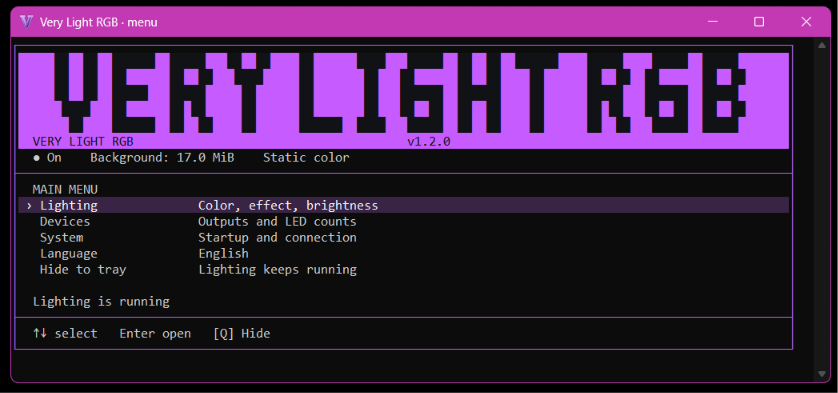

  
  <h1>Very Light RGB</h1>
  
<strong>Your lighting. Your way. A lighter Windows tray.</strong>

  
Make your setup yours with a free, open-source RGB app built to stay small.

  

    <a href="https://github.com/BoringAppDevs/VeryLightRGB/releases/latest/download/VeryLightRGB-Setup-win-x64.exe"><strong>Download for Windows x64</strong></a>
    &nbsp; · &nbsp;
    <a href="https://github.com/BoringAppDevs/VeryLightRGB/releases/latest">Portable &amp; other downloads</a>
    &nbsp; · &nbsp;
    <a href="https://github.com/BoringAppDevs/VeryLightRGB/issues">Feedback &amp; device requests</a>
  

  

    
    
    
  

**Nine built-in effects. 2,000+ device detection entries. Just 3.95 MB of private RAM in our background benchmark.**

Pick your devices, choose your colors, and let your setup shine. Very Light RGB puts everyday lighting controls in a compact, keyboard-friendly menu, then slips back into your system tray. No account. No cloud. No subscription.

## Why Very Light RGB?

- **Keep your resources for what you love.** Native C++ and Win32 keep the app compact. In our local background test, Very Light RGB averaged 3.95 MB of private RAM while animating three ARGB outputs and a GPU.
- **Get effects out of the box.** Choose Solid color, Sequential fill, Orbiting dark block, Breathing, Rainbow ("Gay" in the menu), Two-color fade, Comet, Wave, or Twinkle. No effects plugin to install.
- **Make every output your own.** Set colors, brightness, and effects together or independently. Match your fans to your GPU, or give each its own look.
- **Dial in the details.** Pick from 32 colors or enter a HEX value. Adjust brightness from 0–100%, including Rainbow. Tune speed, direction, and a second color where the effect supports them.
- **Set it once. Enjoy it every day.** Settings save automatically. Optional Windows startup, reconnect handling, and crash recovery help keep your lighting ready.
- **Stay in control.** Lighting works offline. The installer includes the app and native drivers, with no separate OpenRGB installation, Node.js, or .NET runtime needed for Native Auto mode.

## Up and glowing in minutes

1. **[Download the Windows installer](https://github.com/BoringAppDevs/VeryLightRGB/releases/latest/download/VeryLightRGB-Setup-win-x64.exe).** Choose English or Ukrainian and optionally enable startup with Windows. Leave **Launch Very Light RGB** checked to start right away.
2. Open **Devices** and select the outputs you want to control.
3. Open **Lighting**, find your favorite look, and press **Q** to hide the menu. Your lights keep running.

Reopen the menu from the tray icon whenever you want a change. Prefer a portable app? [Download the ZIP](https://github.com/BoringAppDevs/VeryLightRGB/releases/latest/download/VeryLightRGB-win-x64.zip), extract it, and keep the included `native-drivers` folder beside the EXE.

**Requirements:** Windows 10 or 11, x64, and compatible RGB hardware.

## Hardware compatibility

**A broad device catalog, built in.** Very Light RGB includes **2,204 catalog entries across 198 controller families**, backed by an OpenRGB-derived native driver core with **2,144 compiled detector registrations**. Explore lighting across motherboards, graphics cards, keyboards, mice, and RGB controllers from one app.

Open **Devices** to discover your setup and choose what to control. For supported ARGB headers, you can set the strip length manually from **1–120 LEDs**.

Compatibility depends on the model, firmware, and connection mode; catalog entries are detection rules, not a count of individually verified devices. Missing a device or seeing unexpected behavior? **[Open a compatibility issue](https://github.com/BoringAppDevs/VeryLightRGB/issues)** with its model and connection type to help improve support. Use one lighting app per device at a time.

## Less overhead. More room for everything else.

In our Windows 11 background test, Very Light RGB averaged **3.95 MB of private RAM** and **0.099% CPU** while running Rainbow on three ARGB outputs and a GPU, with the menu closed.

| Application | Disk usage | Private RAM | CPU | Our disk usage vs. app | Our RAM usage vs. app | Our CPU usage vs. app |
| --- | ---: | ---: | ---: | ---: | ---: | ---: |
| **Very Light RGB** | **83 MB** | **3.95 MB** | **0.099%** | — | — | — |
| OpenRGB | 51.3 MB | 36.1 MB | 0.028% | **62% more** | **9.1× less** | — |
| SignalRGB | 1.18 GB | 679 MB | 1.092% | **14.2× less** | **172× less** | **90.9% less** |
| MSI Center + Mystic Light | 1.92 GB | 175 MB | 0.167% | **23.2× less** | **44.2× less** | **40.5% less** |
| Razer Chroma + shared Synapse components | ≥2.86 GB | 1.05 GB | 0.113% | **≥34.4× less** | **265.6× less** | **12.4% less** |

Native mode lets supported devices run directly, without a separate SDK server. Additional devices use the bundled native driver worker when needed.

## Download once. Keep it fresh.

**[Get the latest release](https://github.com/BoringAppDevs/VeryLightRGB/releases/latest)** for the Windows installer, portable ZIP, source archive, and SHA-256 checksums. Install a newer build over the existing app to keep your settings.

New app versions are published once under a matching `vX.Y.Z` tag. Documentation updates do not rebuild or republish the app. The installer is currently unsigned; `SHA256SUMS.txt` is included with each release.

## Help make it better

Found a bug, have an effect idea, or want to help a device work better? **[We'd love your feedback](https://github.com/BoringAppDevs/VeryLightRGB/issues).** Include the device model, connection mode, and what happened. Remove serial numbers and personal information from any diagnostics you share.

Code contributions are welcome too. See [Building and releases](docs/BUILDING.md) to get started.

## Open source, with thanks

Very Light RGB is free software under **[GPL-3.0-or-later](LICENSE)**. Thanks to OpenRGB and its contributors for the driver work that helps make broad device coverage possible. Third-party components retain their own licenses; see [COPYRIGHT.md](COPYRIGHT.md). Corresponding source and dependency notices ship with the release packages.
