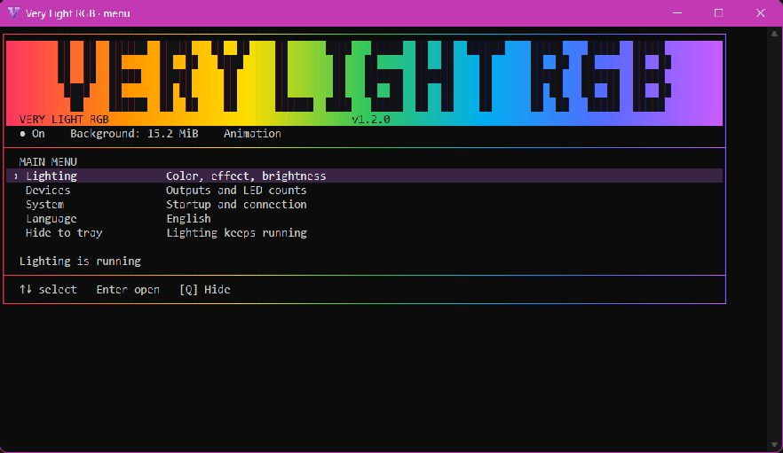

  
  <h1>Very Light RGB</h1>
  
<strong>Simple RGB control. A tiny background footprint.</strong>

  
A free, open-source lighting app for Windows that lives in your system tray.

  

    <a href="https://github.com/BoringAppDevs/VeryLightRGB/releases/latest/download/VeryLightRGB-Setup-win-x64.exe"><strong>Download for Windows x64</strong></a>
    &nbsp; · &nbsp;
    <a href="https://github.com/BoringAppDevs/VeryLightRGB/releases/latest">All downloads</a>
    &nbsp; · &nbsp;
    <a href="https://github.com/BoringAppDevs/VeryLightRGB/issues">Report a problem</a>
  

  

    
    
    
  

Pick your devices, choose a color or an effect, and get back to what you were doing. Very Light RGB keeps your lighting running in the background; its keyboard-friendly menu opens when you need it.

## Get started

1. **[Download the installer](https://github.com/BoringAppDevs/VeryLightRGB/releases/latest/download/VeryLightRGB-Setup-win-x64.exe)** and run it. Choose English or Ukrainian, and optionally enable startup with Windows.
2. Launch **Very Light RGB** from the Start menu or double-click its tray icon.
3. Open **Devices**, select the outputs you want to manage, then open **Lighting** to make them yours.

Press **Q** to hide the menu while your lights keep running. To stop the app, choose **Exit** from the tray menu.

**Requirements:** Windows 10 or 11, x64, and compatible RGB hardware. The installer includes the app and its native drivers; you do not need Node.js, a .NET runtime, or a separate OpenRGB installation to use Native Auto mode. A [portable ZIP](https://github.com/BoringAppDevs/VeryLightRGB/releases/latest/download/VeryLightRGB-win-x64.zip) is available too—keep the included `native-drivers` folder beside the EXE.

## Make your lighting yours

- **Control outputs together or independently.** Give your fans and GPU different colors, brightness levels, and effects.
- **Choose from nine effects:** Solid color, Sequential fill, Orbiting dark block, Breathing, Rainbow ("Gay" in the menu), Two-color fade, Comet, Wave, and Twinkle.
- **Fine-tune the look.** Pick from a 32-color palette or enter a HEX color. Adjust brightness from 0–100% in 5% steps, including the rainbow effect. Applicable effects also expose speed, direction, and a second color.
- **Set the right LED count.** Supported native ARGB headers allow manual lengths of 1–120 LEDs.
- **Set it and leave it.** Settings save automatically. Optional Windows startup, reconnect handling, and crash recovery keep setup simple.
- **Work offline.** No account or cloud service is needed for lighting control.

The app uses native C++ and Win32. A static color does not need a frame-rendering loop. Additional supported devices use a separate native driver worker only while those outputs are selected.

## Hardware compatibility

Physically tested hardware includes:

| Device | Tested control |
| --- | --- |
| MSI MAG B850M MORTAR WIFI | Native ARGB headers |
| Gainward RTX 5080 Phoenix | Native GPU lighting zone |
| Razer Basilisk V3 Pro Wireless | Scroll wheel, logo, and LED strip through the native driver core |

The included OpenRGB-derived driver core contains a much broader detector catalog. **A listed detector is not a guarantee that every model, connection mode, or firmware has been tested.** Check your device in the app, and [open an issue](https://github.com/BoringAppDevs/VeryLightRGB/issues) if it needs investigation. Device names alone do not establish protocol compatibility.

Let one lighting app manage each device at a time. For ordinary ARGB headers, select the connected header and set its LED count manually; the cable does not report the physical number of LEDs.

## How light is it?

In a 60-second Windows test with a 12-LED fan animation and a static GPU color, the native background process averaged **14.8 MiB of RAM** with its menu closed.

| Measured configuration | Mean working set | CPU, whole machine |
| --- | ---: | ---: |
| Very Light RGB, native MSI/Gainward control | **14.8 MiB** | **0.013%** |
| Very Light RGB through OpenRGB SDK, both processes combined | **44.5 MiB** | **0.058%** |

These are measurements from one Windows 11 PC with 16 logical processors, not fixed requirements or a claim about every RGB application. The SDK result includes a **13.8 MiB** Very Light RGB process and a **30.7 MiB** OpenRGB 1.1 CLI server. It does **not** measure OpenRGB's desktop UI or Effects Plugin. Selecting additional native-driver devices adds their worker's resource usage.

See the [benchmark method and anonymized results](docs/benchmarks/README.md) for workload, sampling, and limitations.

## Very Light RGB or OpenRGB?

Both are free and open source. Very Light RGB focuses on a small Windows tray app with straightforward lighting controls. [OpenRGB](https://openrgb.org/) offers a broader cross-platform toolkit and plugin ecosystem.

| | Very Light RGB | OpenRGB |
| --- | --- | --- |
| Interface | Tray icon and an on-demand text menu | Desktop UI and command line |
| Platforms | Windows x64 | Windows, Linux, and macOS |
| Software effects | Nine built-in effects | [Effects Plugin](https://openrgb.org/plugin_effects.html), including audio and screen-driven effects |
| Connections | Native Auto by default; optional OpenRGB SDK mode | Native device support, network SDK, and plugins |
| Best fit | Simple lighting with a small background process | Broader integrations and advanced customization |

You can also use Very Light RGB as a compact front end to an existing OpenRGB SDK server. The resource table above compares those two ways of running **this app**, rather than ranking every feature of the two projects.

## Downloads and updates

**[GitHub Releases](https://github.com/BoringAppDevs/VeryLightRGB/releases/latest)** contains the Windows installer, portable app, corresponding source archive, and `SHA256SUMS.txt`. Install a newer build over the existing app to keep your settings. Uninstalling leaves your settings available for a later installation.

Builds are produced automatically from `main` after source checks, compilation, tests, and release-file checks. The installer is currently unsigned; checksums are included with each release.

## Contributing

Bug reports, compatibility reports, and small improvements are welcome. For a hardware report, include the model, connection mode, and what happened; remove serial numbers, personal paths, and other private information from diagnostics.

Want to build it yourself? See [Building and releases](docs/BUILDING.md). Most users can simply download the installer above.

## License and acknowledgments

Very Light RGB is licensed under **[GPL-3.0-or-later](LICENSE)**. The native driver core builds on OpenRGB and its contributors' work. Third-party components retain their own licenses and notices; see [COPYRIGHT.md](COPYRIGHT.md). Corresponding source and dependency notices are included in the release packages.
